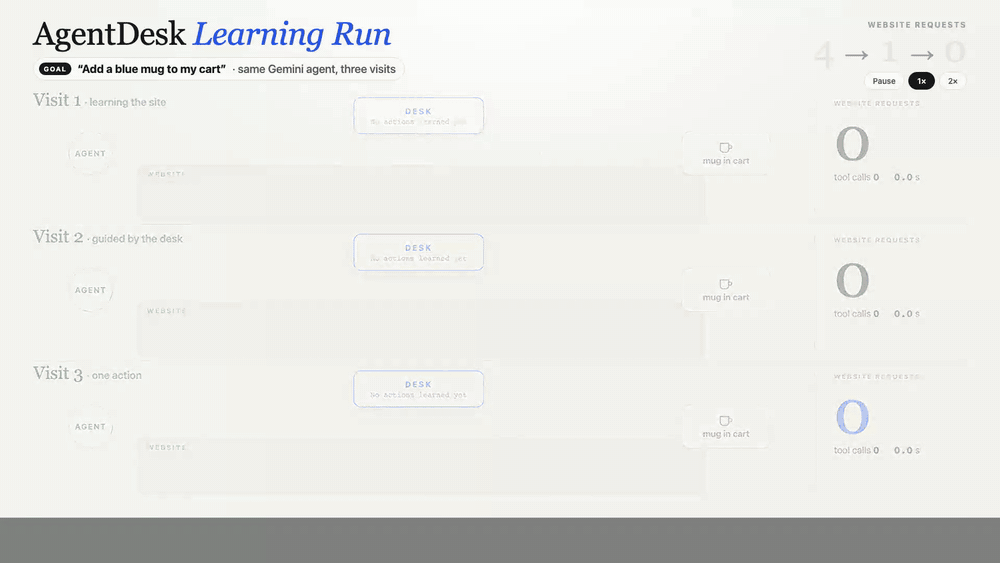
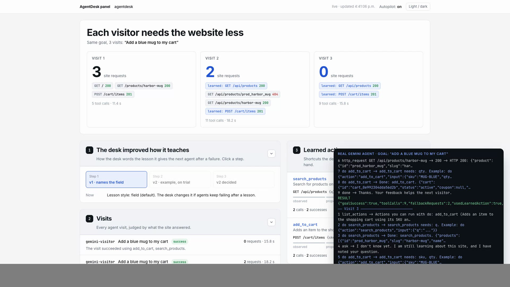

# AgentDesk

**Drop it in. It knows nothing. Every agent that visits teaches it.**



*A real Gemini agent, same goal three times ("Add a blue mug to my cart"). Visit 1 works through the website and gets a 400, then a 201; the desk keeps the request the site accepted and turns it into an action. Visit 2 follows it. Visit 3 needs no website requests at all.* [Open the interactive version](https://htmlpreview.github.io/?https://github.com/AndresCarreonDiaz/agentDesk/blob/main/docs/demo/learning-run.html)

**The live developer panel during a real run** (3 → 2 → 0 site requests, learned actions in blue, Gemini's actions in the corner):



AgentDesk is a front desk for AI agents. A developer drops it into any platform (an online store, an image generator, an insurance quote site) with one line. On day one it is empty: no docs, no tool list, no config. It just starts accepting agent traffic.

## Install (it should feel like a toggle)

```bash
npm i agentdesk
```

```bash
# .env: MONGODB_URI is usually there already, because the site runs on MongoDB
MONGODB_URI=...          # your own Atlas cluster: the desk's memory lives here
GEMINI_API_KEY=...       # or ANTHROPIC_API_KEY / OPENAI_API_KEY: the desk thinks with your own LLM key
VOYAGE_API_KEY=...       # optional: embeddings for matching requests (Gemini makes them otherwise)
```

Minimum: two keys, `MONGODB_URI` and `GEMINI_API_KEY`. Copy [.env.example](.env.example) to start.

```ts
app.use(agentdesk())
```

That is all. On first start AgentDesk creates its own `agentdesk` database in your cluster (it never touches your app's collections), opens its door to agents, and prints a private link to your panel at `/agentdesk`. No AgentDesk account, no AgentDesk servers.

Agents always see the same five tools: `about`, `ask`, `list_actions`, `do` and `done`. What the desk learns shows up inside `list_actions`, so agents never need to reconnect.

## Autopilot (on by default)

You should not have to approve everything, or the desk gets stuck. On autopilot, everyday actions the desk learns (add to cart, apply a filter, request a quote) go live for agents right away. **Anything that moves money (checkout, payment, orders, refunds) still waits for your one click.** Every action autopilot runs before you have reviewed it is written to an audit log; later you open the panel and keep it or block it. Your rules ("agents may not apply discount codes") always win. Turn it off with one toggle in the panel, or start with `AGENTDESK_AUTOPILOT=off`.

It is safe because the desk only replays requests your site already accepted from that agent on the website itself, through the same endpoint and the same validation: autopilot adds speed, not new permissions.

Every agent that arrives teaches it something. The first agent asks "what can I do here?" and leaves without an answer. AgentDesk records why it failed, goes and learns the answer, and the next agent gets one. That agent then wants to add something to a cart and gets stuck. AgentDesk watches how the request finally got done, turns it into a capability, and the agent after that does it in one call.

The developer watches it learn in real time, and steers it: approve a capability, block one ("agents may not apply discount codes"), or correct an answer. Each correction becomes part of what AgentDesk knows.

## Why now

Consumer agents like OpenAI's dots and Meta's Muse now shop, book and fill forms on people's behalf, around the clock. They land on websites built for humans and burn minutes clicking through pages, or give up. Every platform needs a way to serve agent visitors, but nobody has time to hand-write an agent API for a site that keeps changing. AgentDesk writes its own, from real traffic.

## How it learns, visit by visit

Agents only ever talk to the desk's MCP (or `POST /agent`). Proven live on the demo store, from an empty database:

| Visit | The agent asks | What the desk does | Result |
|---|---|---|---|
| 1 | "What can I do here?" "Add a blue mug to my cart." | Knows nothing yet: says so honestly. After the visit it **reads its own site** (`/llms.txt`, pages, forms) | Learns 6 facts about the store and 2 actions (`search_products`, `add_to_cart`) in about 20 s |
| 2 | "What can I do here?" "Do you ship to Austin?" "Add a blue mug." | Answers from what it learned, offers `add_to_cart`, runs it on autopilot and writes it to the audit log | Mug in the cart **in one call (343 ms)**; `add_to_cart` becomes **verified** |
| later | Something the desk still cannot do | Watches how it finally got done on the website (the tap), or the diff between a failure and a success, and learns from that too | More actions, lessons from failures, proposed guardrails |

The numbers that prove it: **task success rate, steps per task and seconds per task, plotted against visit count.** Run it yourself: `npm run demo:mcp` against a store with AgentDesk on a fresh database.

## What is in this repo

- [docs/CONCEPT.md](docs/CONCEPT.md): the product, the learning loop, developer control
- [docs/ARCHITECTURE.md](docs/ARCHITECTURE.md): components, data model, memory, sponsor tools
- [docs/DEMO.md](docs/DEMO.md): the 3 minute stage demo and the 1 minute video
- [docs/PLAN.md](docs/PLAN.md): today's build plan, cut lines and fallbacks
- [docs/CONTRACT.md](docs/CONTRACT.md): shared data shapes and rules that all parts code against
- [docs/parts/](docs/parts/): one doc per part (store, door, loop)
- [AGENTS.md](AGENTS.md): start here if you are a coding agent
- [docs/STORE_PRD.md](docs/STORE_PRD.md): Harbor Goods demo store: why it exists, research cuts, demo contract
- [docs/STORE_SPEC.md](docs/STORE_SPEC.md): Harbor Goods build spec: Atlas schemas, HTTP, pages, seed

## Hackathon fit

Built at the Harness Engineering & Model Wrangling #SFTechWeek Hackathon (MongoDB, 11 Oct 2026).

- **Recursive Harnessing:** AgentDesk evolves its own tools, answers and guardrails to fit the specific platform it was dropped into.
- **Long Horizon Engineering:** it keeps a memory of every visit, every failure and every correction, and optimises against hard numbers (success, steps, time).

## Hackathon tools we use

| Tool | What AgentDesk uses it for |
|---|---|
| **MongoDB Atlas** (hackathon sandbox cluster) | The desk's whole memory, in its own database inside the developer's cluster: visits, tapped requests, learned facts, learned actions, rules, the audit log and settings. Flexible documents fit any host platform. |
| **Atlas Vector Search** | Three vector indexes (knowledge, capabilities, intents) match an agent's free-text request to what the desk learned. Search falls back to in-process cosine while an index is still building. |
| **Voyage AI through Atlas** (AI Model APIs) | Embeddings (`voyage-3.5`, 1024 dimensions) via `ai.mongodb.com` with an Atlas model API key. Each database locks its embedding provider on first start. |
| **Gemini** (`gemini-3.8-flash`) | The desk's thinking: routing a plain-language request to a tool, answering only from learned facts, naming learned actions, reading the site's own pages. |
| **MCP** (Streamable HTTP) | The five fixed agent tools, stateless, so restarts and several instances lose nothing. |
| **Raindrop** | One event per closed visit from the Loop, with success and abandon signals. |
| **Modelence** | Hosts Harbor Goods with AgentDesk inside: the public demo link. |

**Atlas Agent Engine** is not used, on purpose. AgentDesk runs inside the developer's own app with one line and their own keys, while Agent Engine runs agents on its hosted runtime. AgentDesk keeps the same ideas in its own Atlas collections (long-term memory, an action allowlist by stage, rules enforced on every path, an audit log). Exporting learned actions as Agent Engine tools is a natural next step.

## Team

| Part | Who | What |
|---|---|---|
| Door | Andres | The drop-in: `agentdesk()` install, tap, discovery, the five agent tools on `/agent` and `/mcp`, rules |
| Loop | Ricardo | The learning: episode close, reflector, capability stages, metrics, Raindrop |
| Store | Sebastian | The demo store that installs AgentDesk with one line, visitor agents, the developer panel |

## Status

Contract v2 agreed. Code lands here during the event.

## Contributing: secret gate

This repo is public. Before your first commit, enable the pre-commit secret scan:

```bash
brew install gitleaks
./scripts/setup-hooks.sh
```

The hook blocks `.env` files, private keys, and other credential files, and runs `gitleaks` on staged changes. CI runs the same scan on every push and pull request.
